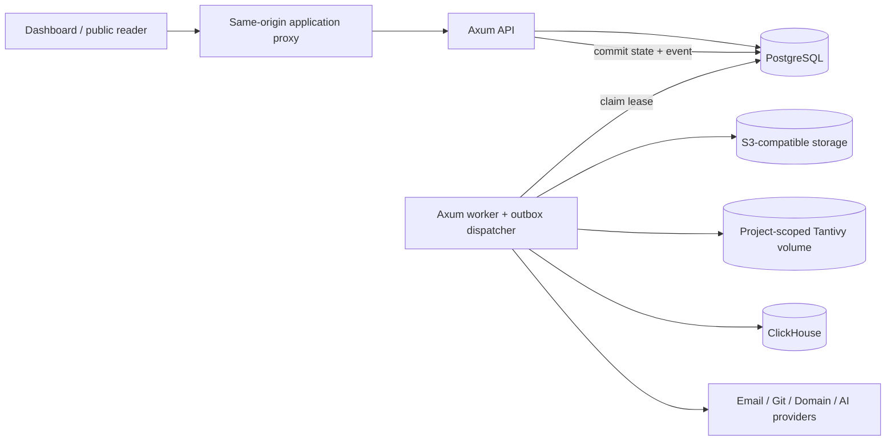

# Target architecture: Nibleaf Rust platform

> **Current staged-search delta — ADR-0017 (2026-10-16):** the distinct opt-in native public transport, in-budget native/transition read-only identity, selected UTF-16/literal contract, scoped BM25/stable pre-limit ties, bounded owned JSON, aggregate-only metrics, offline rebuild and local load/network/HTTP proofs are implemented. It is **disabled by default**, with no production routing, UI/caller selection or legacy removal. Earlier statements below that transport/scoring are unimplemented describe the prior milestone and are superseded by the [current candidate contract and release boundary](../operations/public-search-candidate.md). Selected 200-UTF-16 native validation differs from installed Zod 4.5.4 scalar counting; no exact Unicode parity claim.

## Decision summary

Nibleaf will evolve as a **PostgreSQL-backed modular monolith** with independently deployable Axum API and worker binaries. The first Rust workspace is at [`rust/`](../../rust), deliberately nested while legacy TypeScript remains operational. This avoids a destructive repository flip before feature parity and migration evidence exist.



The Tantivy node is the selected lexical-only target, backed by a persistent shared project-generation volume. A tenant-authorized project-member route reads the active generation. A separate non-HTTP composition derives fresh public-reader admission, highest-READY selection and published ceilings intersected with live restrictions; neither is the live public reader path. Qdrant and Orama are legacy compatibility components to be removed only through ADR-0013's reviewed cutover, not target dependencies.

The API never calls an unreliable provider while holding a PostgreSQL transaction. A state change that requires durable async work appends an `outbox_event` in the same transaction. The worker claims rows with `FOR UPDATE SKIP LOCKED`, assigns a fresh database-generated lease token to **each claim** (fencing stale claims, including from the same worker), records delivery/retry/dead-letter state, and requires idempotent consumers.

## Workspace and dependency direction

```text
rust/
├── apps/
│   ├── api/                 # bootstrap, HTTP composition, health/middleware
│   └── worker/              # lifecycle-owned dispatcher + worker health
├── crates/
│   ├── core/                # IDs, config, problem details, actor/project fence
│   ├── outbox/              # append, claim, lease, retry, replay primitives
│   ├── projects/            # create/list project + recoverable onboarding
│   ├── membership/          # project-tenant role and ownership mutation slices
│   ├── content/             # draft page slices
│   ├── publishing/          # snapshot/publish slices
│   └── search/              # lexical index/registry + owned query service/driver
├── migrations/
└── scripts/
```

Allowed dependency direction:

```text
apps → feature crates → core
apps → outbox → core
feature crates → outbox → core
core → external libraries only
```

Feature crates never depend on another feature crate in phase one. A feature needing a durable cross-feature action emits a versioned outbox event rather than importing an unrelated feature implementation. This is intentionally smaller than MedBrains' broad crate graph while retaining its useful vertical feature ownership.

`rust/scripts/check-architecture.sh` enforces the declared crate graph using `cargo metadata`; it is not a brittle source-text rule.

## HTTP boundary

- Versioned Rust API prefix: `/v1`.
- Typed Serde bodies with `deny_unknown_fields`; a shared `StrictJson` extractor maps malformed JSON, wrong media types and schema rejections into the same RFC 9457 contract; explicit body cap is 2 MiB.
- An outer response normalizer maps framework-generated route-not-found, method-not-allowed, payload-limit, timeout and panic responses into RFC 9457 too. It preserves `X-Request-Id` and the protocol `Allow` header on a `405`.
- Success uses `{ "data": ... }`; errors use RFC 9457 Problem Details with no SQL messages or internal stack trace.
- A request uses a legacy Better Auth session token only during transition. Exactly one bearer credential or the explicit `nibleaf_session` migration cookie may be presented; ambiguous or malformed credentials fail closed. The actor is queried from `session` joined to unsuspended/unbanned `user` on each request.
- A project ID in a path is not a tenant credential. `require_project_role` joins `project` to `member` using the authenticated user and returns `404` for absent **or unauthorized** projects.
- Same-origin deployment is the safe default; permissive credentialed CORS is not installed.
- Liveness and readiness are separate: `/health/live` is process liveness; `/health/ready` verifies PostgreSQL. API/worker startup refuse a missing Rust platform migration.

## Tenant/data model

The selected model is shared PostgreSQL tables with the existing per-project organization boundary:

```text
User --< Member >-- Organization (tenant) --1 Project --< Language / Branch / Page / Deployment
```

This preserves current ownership and avoids a schema-per-tenant migration burden. Tenant-scoped mutations must carry a `ProjectScope` derived server-side. No client organization ID is trusted. The phase-one Rust design uses explicit SQL scope joins rather than PostgreSQL RLS; that choice avoids connection-pool session context leakage during a mixed Prisma/SQLx transition. RLS may be evaluated later only with transaction-local context and pool-leak tests.

Implemented constraints:

- unique `(projectId, languageId, branchId, path)` on `page` after duplicate preflight;
- non-negative page `revision`, used for compare-and-swap updates;
- composite project/organization foreign key for onboarding runs;
- one active `PENDING`/`BUILDING` deployment per project;
- constrained member-role vocabulary and at-most-one owner partial unique index per organization;
- outbox state/lease/attempt checks and tenant FK.

## Implemented transaction boundaries

| Slice | Transaction | Async intent | Recovery |
|---|---|---|---|
| Create project | Organization + owner membership + project + default language/branch + onboarding run | `project.initialized` appended before commit | Event is leased/retried; consumer idempotently marks onboarding complete. |
| Update page | Project scope is checked before a single revision-guarded update | None | Caller receives 409 and refreshes. |
| Request publication | Advisory/project share locks, one-statement format-2 capture of every version/locale/page and deployment insert | Tenant-scoped `search.generation.requested` and `publication.requested` are appended in the same commit | Partial index prevents concurrent publication; both events carry the same canonical JSON identity. |
| Complete publication | Worker locks the deployment, leaves it `BUILDING` while the matching registry row is absent/pending/building, then persists `READY` and `publication.ready` only after registry promotion | Search registration/build is independently leased; ready notification follows promotion | A crash or reverse outbox delivery order causes retry, never early `READY`; a terminal registry failure marks the deployment `FAILED`. |
| Native search generation | Publication event is tenant/project/deployment/snapshot-bound; worker idempotently registers one UUID, leases it, builds outside a DB transaction, and promotion updates the row and project active pointer together | `search.generation.requested` owns registration and joined build/promotion | Fresh registry tokens fence stale workers; a failed/reclaimed build cannot replace the previous pointer. |

The guarantee is **atomic database change plus at-least-once delivery intent**, not exactly-once external delivery.

## Scheduling and jobs

The legacy product has BullMQ recurring analytics/export scheduling and durable export records. Those have not been mechanically replaced. The implemented Rust worker uses only the outbox because project initialization and publication require immediate durable work; it does not introduce a speculative general scheduler.

When exports/recurring maintenance are ported, the selected initial design is PostgreSQL `scheduled_job` rows with explicit timezone/misfire/cancellation/lease semantics **or** a maintained Rust job library, chosen through an ADR spike against the verified export requirements. In-memory timers are prohibited.

## Native search implementation boundary

Project-local generations use snapshot/source format 2 and runtime-bound manifest 3, freezing exact version IDs/slugs, enabled locales, eligibility and result fields. Stored-source checksum recomputation and closed-schema validation bind routing/rendering evidence to promotion. Only visible/indexable enabled-language pages are indexed; an empty corpus is valid. The member-only route supports optional exact version/locale filters with private/no-store responses.

Read-only public admission derives a live project-bound `PUBLIC`/`WORKSPACE`/`READERS` page scope. [ADR-0015](decisions/0015-published-search-ceilings-and-ready-selection.md) now composes it with the highest READY deployment, exact registry evidence and current live restrictions in one short REPEATABLE READ / READ ONLY transaction. Publication capture retains its existing READ COMMITTED/lock protocol. The transaction commits before the opaque one-shot operation is synchronously executed. Exact version, eligible-language set and reader-page terms intersect before TopDocs; a broken latest READY generation never falls back.

The user selected published eligibility/defaults and cap as ceilings, narrowed by live enabled flags/cap. This intentionally differs from legacy live overlays and its forced default-language serving; see the [policy guide](../migration/native-public-search-scope.md). Preparation starts no task or filesystem work; execution is synchronous and consumes the request-local operation. [ADR-0016](decisions/0016-supervised-search-query-lifecycle.md) now gives member HTTP and a non-HTTP published facade one feature-owned bounded service/driver, injected at API composition rather than into core. Admission covers feature preparation, transfer/validation ceilings, retained SQL futures/cleanup and joined blocking execution. The API jointly drives HTTP and search, cancels/drains on either server exit or signals, and closes the pool afterward. Public optional-actor/session transport, route/schema/cache/errors/analytics/relevance/privacy, hard resource/failure and load validation remain gates; global auth/extraction is outside the feature budget. Full snapshot hashing/generation validation is currently O(publication size), not a load-ready public-query design.

[Format-2 migration](../migration/native-search-format2.md) is a deliberate fail-closed native format expansion, not an in-place conversion or an Orama/Qdrant fallback. The volume now includes readable authored page bodies and retained generations, so native index writers/storage belong in future erasure/fence and operations review. The four active search audit warnings are remediated under [ADR-0014](decisions/0014-search-runtime-dependency-remediation.md), with strict warning denial, checked native Lindera failures and a verified manifest-only Tantivy dependency patch. The [runtime migration](../migration/native-search-runtime-upgrade.md), patch maintenance and remaining public/operations gates still apply.

## Publishing contract

A draft remains mutable in `page`. A publication captures a JSON snapshot in the transaction that creates `deployment` and records both publication and native-search intent. The worker transitions it `PENDING → BUILDING → READY` only after the deployment-bound generation is promoted; absent/pending/building generation state is retried, while a terminal generation failure becomes `FAILED`. Public reader work must select READY only. Thus a later draft edit cannot change an already-created snapshot, and a failed/new build cannot replace the last valid published deployment.

The completion consumer is database-only; native search is a separate implemented leased build/promotion workflow outside its transaction. Full validation/rendering/assets/redirect/rollback and public-reader compatibility are still required before public delivery moves to Rust.

## Operational model

- API and worker use separate binaries and health ports (`4311`, `4312` defaults). `/metrics` requires a distinct, secret-managed bearer token; health endpoints remain available for orchestration.
- Database migrations run as a controlled one-shot deployment step, never implicitly in an API request or startup.
- Logs are structured `tracing` JSON and omit headers/secrets/payloads by default.
- Implemented metrics: Prometheus text on `/metrics` for bounded HTTP request count/duration labels; scrape-time local SQLx pool gauges; and worker claim/reclaim, delivery/outcome-duration, persistence-error and backlog snapshot health/count/age gauges. HTTP spans/metric labels use Axum route templates (or `unmatched`) and known methods (or `OTHER`), never raw URI/query/headers/fallback paths or custom-method text. Bounded query rejection/outcome/full-lifecycle metrics are also implemented; see the [runtime runbook](../operations/search-query-runtime.md). Before broader production cutover, set operational thresholds/ownership, add publication-state gauges and trace correlation/export.
- API jointly drains HTTP and owned query work before pool close; cancellation does not free capacity while SQL/CPU work still runs. There is no hard drain/CPU/I/O or aggregate RSS guarantee. Worker uses cancellation-aware graceful shutdown. An in-flight worker lease is recoverable after expiry; delivery is not acknowledged early.

Detailed decisions are in [`decisions/`](decisions/).
